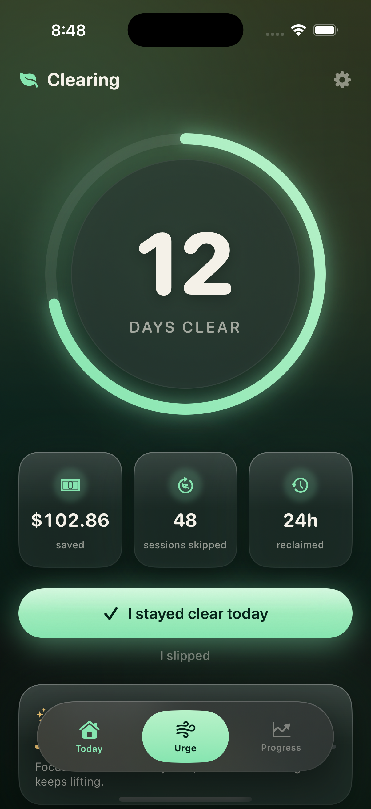
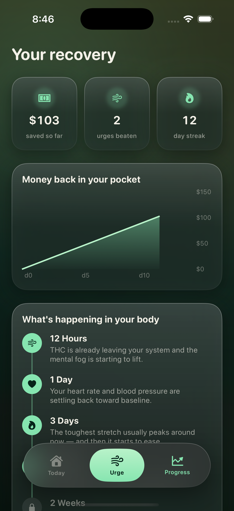
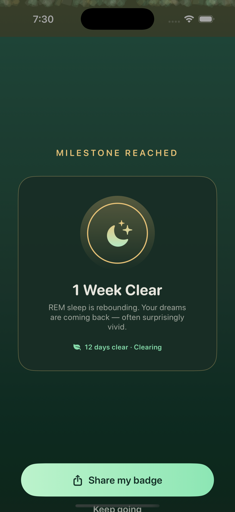
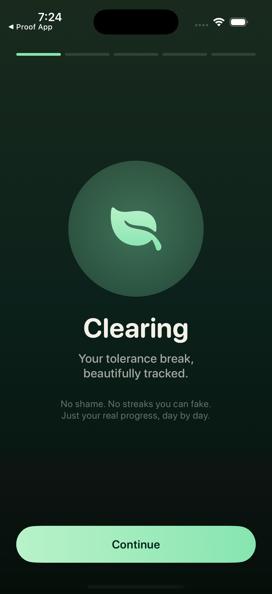
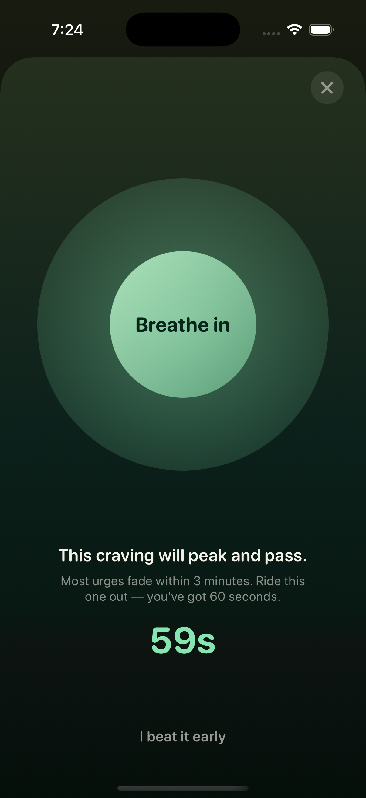
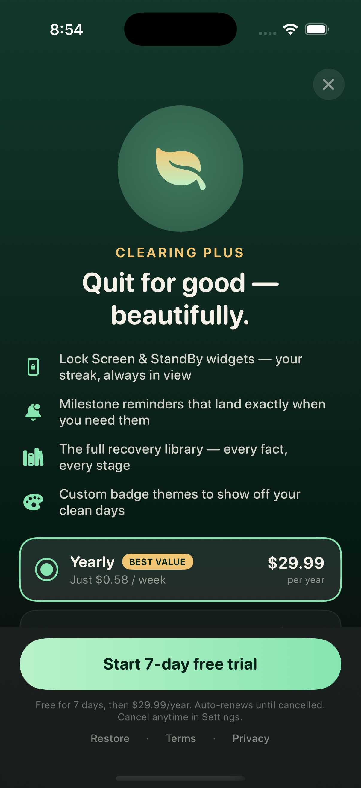
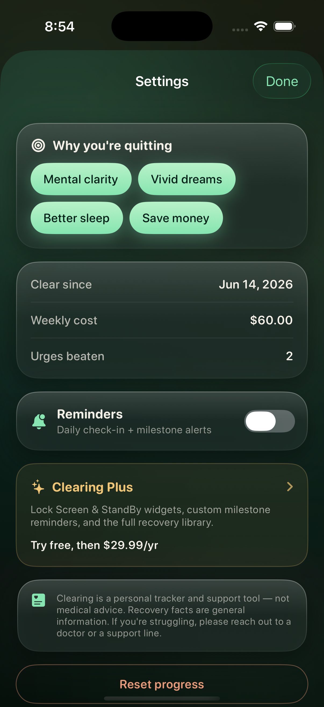

# Clearing

**Your tolerance break, beautifully tracked.**

A quit-weed / T-break tracker for iOS. One number that climbs. The money you didn't burn. The night your dreams come back. Built because the apps in this category work but look like a parking ticket.

<p align="center">
  
  
  
</p>

## Why this exists

Clearing came out of a niche hunt: find a single-purpose app category that demonstrably makes money (the viral vape-puff-counter pattern), then build the better-designed version. Quitting cannabis was the pick. It has the retention mechanics that print (streak, money saved, milestones), a demo that is native to TikTok, and incumbents that score low on craft. The whole wedge is design and tone: calm and kind, never shame. Slip and the app says "that took guts," not "you failed."

## Features

- **Live hero counter** — days clear, money saved, sessions skipped, and hours reclaimed, all ticking in real time.
- **Recovery timeline** — cannabis-specific milestones (REM rebound and vivid dreams around day 7, sharper focus at two weeks, full tolerance reset by day 90), a money-saved chart, and a clean-day calendar.
- **Urge tool** — a 60-second guided breath that logs every craving you ride out as a small win.
- **Milestone celebrations** — confetti and a shareable badge built for sharing with no editing.
- **Widgets** — Lock Screen, StandBy, and home-screen, showing your streak and money saved.
- **Reminders** — a daily check-in and a nudge as each recovery milestone lands.
- **Paywall** — real StoreKit 2, with a bundled `.storekit` config so purchases work in the simulator.

## Screens

| Onboarding | Home | Recovery | Urge |
|---|---|---|---|
|  |  |  |  |

| Milestone | Paywall | Settings | Icon |
|---|---|---|---|
|  |  |  |  |

## Tech

- SwiftUI, iOS 17+. The Observation framework (`@Observable`).
- 100% local — Codable + UserDefaults. No backend, no accounts.
- StoreKit 2 for purchases (`Products.storekit` for simulator testing).
- A WidgetKit extension (App Group for shared state).
- UserNotifications for the daily and milestone reminders.
- Swift Charts for the money-saved graph.

## Project layout

```
Clearing/             app sources
  Model/              data, store, notifications, widget sync
  Design/             theme, components, haptics
  Views/              one file per screen
ClearingWidget/       widget extension (Lock Screen / StandBy / home)
Products.storekit     StoreKit test configuration
ClearingWidgetInfo.plist
Clearing.xcodeproj    hand-generated (Xcode 16+ synchronized folders)
TIKTOK.md             build-in-public launch scripts
```

The Xcode project was generated without the GUI, using synchronized source folders — drop a `.swift` file into `Clearing/` and it is in the build with no project edits.

## Build & run

1. `open Clearing.xcodeproj`
2. Select the **Clearing** scheme and an iOS 17 simulator.
3. Run. The first launch is onboarding. On the hero screen there is a DEBUG **+7 days** control to fast-forward a streak for testing.

## Before TestFlight

A few steps that need the Xcode GUI / a signing team:

- Create the products in App Store Connect: `com.jarvis.clearing.annual`, `com.jarvis.clearing.monthly`, `com.jarvis.clearing.lifetime`.
- Add the App Group `group.com.jarvis.clearing` to **both** targets so the widget reads real data instead of the sample snapshot.
- Confirm **Edit Scheme → Run → Options → StoreKit Configuration** is set to `Products.storekit`.
- Set a real signing team.

## Status

Builds and runs in the simulator. Billing is real StoreKit 2; it needs App Store Connect products to go live. The hard part from here is distribution, not code — `TIKTOK.md` has the launch angles.

---

© 2026 Chris DiMarco. All rights reserved. Add a `LICENSE` file before open-sourcing.
